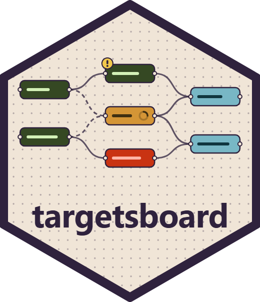
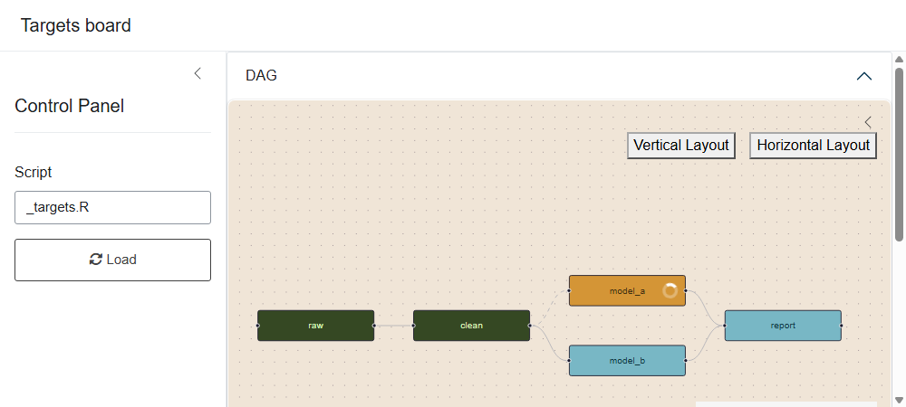
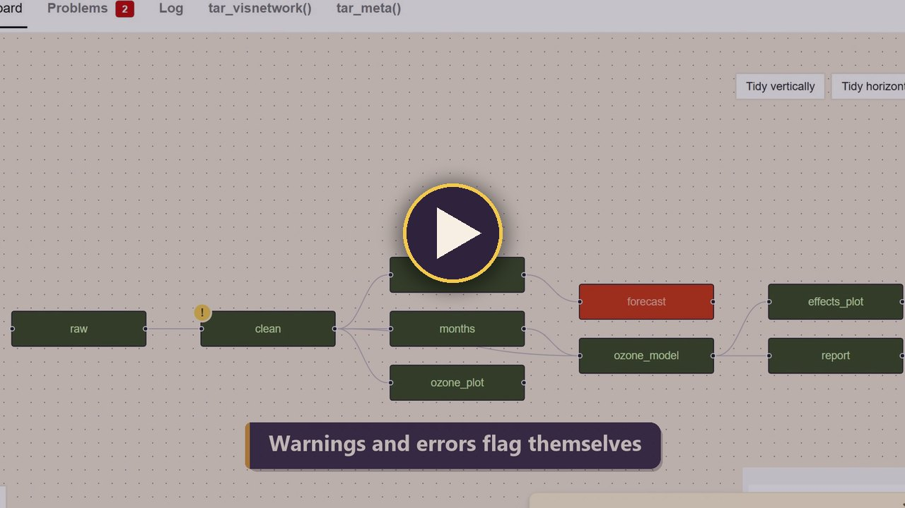

<!-- README.md is generated from README.Rmd. Please edit that file -->

```{r, include = FALSE}
knitr::opts_chunk$set(
  collapse = TRUE,
  comment = "#>",
  fig.path = "man/figures/README-",
  out.width = "100%"
)
```

# targetsboard 

<!-- badges: start -->
[](https://lifecycle.r-lib.org/articles/stages.html#experimental)
[](https://github.com/Athospd/targetsboard/actions/workflows/R-CMD-check.yaml)
[](https://app.codecov.io/gh/Athospd/targetsboard)
<!-- badges: end -->

A board for the author of a [targets](https://docs.ropensci.org/targets/)
pipeline, to understand it while working on it: its structure, what is
outdated, what each target produced and what a run is doing. It is meant to
replace `targets::tar_watch()` for the author. The DAG is drawn with
[React Flow](https://reactflow.dev): targets are coloured by status (up to
date, outdated, running or errored), running targets show a spinner and the
edges feeding them are animated, and targets whose last build raised
warnings carry a warning mark. Clicking a target focuses it: what it depends
on and what depends on it stay highlighted, and its value is previewed.
When the pipeline changes, targets already drawn keep their place.



Watch the board in a demo of under 2 minutes, with sound: a pipeline running,
shaping the DAG, value previews, and an error found, fixed and rebuilt.

[](https://youtu.be/pEsTN9rke2U)

**Early stage.** Help, support and ideas are welcome!

## Installation

```r
remotes::install_github("Athospd/targetsboard")
```

## Usage

In your normal targets workflow, launch the board with `tar_board()`. It runs
in a background R process, so your session stays free:

```{r example, eval = FALSE}
library(targetsboard)

app <- tar_board()                     # opens the board in your browser

targets::tar_make()                    # the board follows along

app$is_alive()
readLines(app$get_output_file())       # the board's log
browseURL(attr(app, "url"))            # reopen it after closing the tab
app$kill()                             # shut it down, or press the power button
```

You can also run the pipeline from the board. **Run all** makes the whole
pipeline, and **Stop** kills the run going, wherever it was started.
**Invalidate all** makes every target outdated with `targets::tar_invalidate()`,
so the next run builds them all again: it asks first, and is disabled while a
run is going. To run or invalidate some targets, right-click one, or use the
toolbar over it. Ctrl-click (Cmd-click on a Mac) or Shift-drag selects several
targets, and the menu can select what a target depends on or what depends on
it: the menu and toolbar of a group act on all of it. Two switches under
**Run all** help debugging: **Keep going after errors** builds what it can
after an error, and **Stop at warnings** turns warnings into errors, so they
leave a workspace. Runs from the board go on if the board stops.

When a target errors or warns, its value preview starts with its problem:
the error or warnings, the traceback through your own functions, and code to
copy into the console, to reproduce it from what the target had or to stop in
the debugger inside it (`debug_run_script()`). The **Problems** tab lists
every target with a problem, and the **Log** tab shows the latest run's
output. While a run goes, a pattern shows how many of its branches are done.

Like `targets::tar_watch()`, `tar_board()` needs no arguments: it shows
the current project's pipeline, using the script and store from its targets
configuration (`_targets.R` and `_targets/` unless `_targets.yaml` says
otherwise). The graph comes from the script, since the store only records
statuses; without a script yet, the board starts empty and draws the pipeline
once the script appears. As `tar_watch()` does, `tar_board()` serves it on a
random free port (or the `shiny.port` option), waits until it is up, opens it
in your browser and prints its url; `browse = FALSE` skips the browser.
It also takes a `script`, a `port`, a `host` and `targets_only`, and
`scripts`: other scripts to switch to, listed in the board's Script field,
which filters them as you type. To run the board in the foreground, or deploy it, use the
Shiny app object instead:

```{r foreground, eval = FALSE}
shiny::runApp(tar_board_app(script = "_targets.R"))
```

### Example pipelines

From a clone of this repository, `inst/examples/pipelines/` has pipelines to
try the board with: a bootstrap analysis with dynamic and static branching,
row groups and values of unusual types; one pipeline per situation the tests
cover (a slow run, problems, run modes, groups of targets, ...); and two
bootstraps at scale. Each is a targets project, with its own store:

```{r examples, eval = FALSE}
Sys.setenv(
  TAR_CONFIG = "inst/examples/pipelines/_targets.yaml",
  TAR_PROJECT = "bootstrap" # or test_problems, test_slow, ...: see the file
)
targets::tar_make()
targetsboard::tar_board()
```

### The DAG widget in your own Shiny app

`targetsboard()` and `update_targetsboard()` take the nodes and edges of
`targets::tar_visnetwork()`:

```{r widget, eval = FALSE}
library(shiny)
net <- targets::tar_visnetwork(targets_only = TRUE)$x

ui <- fluidPage(targetsboard("dag", net$nodes, net$edges, height = "600px"))

server <- function(input, output, session) {
  observe({
    invalidateLater(2000)
    net <- targets::tar_visnetwork(targets_only = TRUE)$x
    update_targetsboard(session, "dag", net$nodes, net$edges, height = "600px")
  })
  observe(print(input$dag_focused_node)) # id of the focused target
}

shinyApp(ui, server)
```

`tar_visnetwork()` hashes the whole pipeline, which gets slow on big ones. To
follow a running pipeline, push only the statuses from `targets::tar_progress()`
with `update_targetsboard_status()`: the widget updates them in place.

```{r widget-status, eval = FALSE}
progress <- targets::tar_progress()
update_targetsboard_status(session, "dag", setNames(progress$progress, progress$name))
```

## Development

- The React front end lives in `srcjs/`. The built bundle in
  `inst/htmlwidgets/` is committed, so installing needs no Node. After
  changing `srcjs/`, run `npm ci` once, then `npm run build` and commit the
  bundle (CI checks it is up to date). `npm run dev` / `npm run watch` make
  a development build with a source map.
- `dev/` holds scripts for running the board while developing; example
  pipelines are in `inst/examples/`.
- Tests: `devtools::test()`. The browser test needs Chrome and is skipped
  on CRAN.
