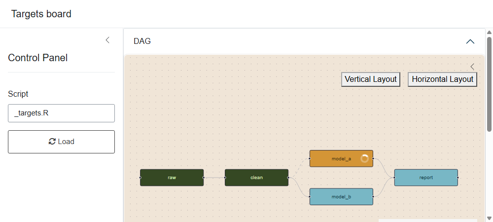

<!-- README.md is generated from README.Rmd. Please edit that file -->

# targetsboard

<!-- badges: start -->

[](https://lifecycle.r-lib.org/articles/stages.html#experimental)
[](https://github.com/Athospd/targetsboard/actions/workflows/R-CMD-check.yaml)
[](https://app.codecov.io/gh/Athospd/targetsboard)
<!-- badges: end -->

An experimental alternative to `targets::tar_watch()` to monitor and run
[targets](https://docs.ropensci.org/targets/) pipelines from a Shiny +
React UI. The DAG is drawn with [React Flow](https://reactflow.dev):
targets are coloured by status, running targets show a spinner and the
edges feeding them are animated, and clicking a target previews its
value.

<figure>

<figcaption aria-hidden="true">The board while tar_make() runs: model_a
is running</figcaption>
</figure>

**Early stage.** Help, support and ideas are welcome!

## Installation

``` r
remotes::install_github("Athospd/targetsboard")
```

## Usage

In your normal targets workflow, launch the board with `tar_board()`. It
runs in a background R process, so your session stays free:

``` r
library(targetsboard)

app <- tar_board()                     # serves http://127.0.0.1:9999
browseURL("http://127.0.0.1:9999")

targets::tar_make()                    # the board follows along

app$is_alive()
readLines(app$get_output_file())       # the board's log
app$kill()                             # shut it down
```

You can also run the pipeline from the board. **Run all** makes the
whole pipeline, **Run selected** makes the targets selected in the DAG
and whatever they depend on that is outdated, and **Stop** kills the run
going, wherever it was started. Runs from the board go on if the board
stops.

`tar_board()` takes the pipeline `script` (default `_targets.R`), a
`port` and `targets_only`. To run the board in the foreground, or deploy
it, use the Shiny app object instead:

``` r
shiny::runApp(tar_board_app(script = "_targets.R"))
```

### The DAG widget in your own Shiny app

`targetsboard()` and `update_targetsboard()` take the nodes and edges of
`targets::tar_visnetwork()`:

``` r
library(shiny)
net <- targets::tar_visnetwork(targets_only = TRUE)$x

ui <- fluidPage(targetsboard("dag", net$nodes, net$edges, height = "600px"))

server <- function(input, output, session) {
  observe({
    invalidateLater(2000)
    net <- targets::tar_visnetwork(targets_only = TRUE)$x
    update_targetsboard(session, "dag", net$nodes, net$edges, height = "600px")
  })
  observe(print(input$dag_selected_nodes)) # ids of the selected targets
}

shinyApp(ui, server)
```

`tar_visnetwork()` hashes the whole pipeline, which gets slow on big
ones. To follow a running pipeline, push only the statuses from
`targets::tar_progress()` with `update_targetsboard_status()`: the
widget updates them in place.

``` r
progress <- targets::tar_progress()
update_targetsboard_status(session, "dag", setNames(progress$progress, progress$name))
```

## Development

- The React front end lives in `srcjs/`. The built bundle in
  `inst/htmlwidgets/` is committed, so installing needs no Node. After
  changing `srcjs/`, run `npm ci` once, then `npm run build` and commit
  the bundle (CI checks it is up to date). `npm run dev` /
  `npm run watch` make a development build with a source map.
- `dev/` holds scripts for running the board while developing; example
  pipelines are in `inst/examples/`.
- Tests: `devtools::test()`. The browser test needs Chrome and is
  skipped on CRAN.
